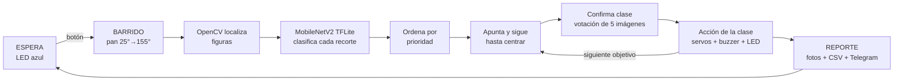
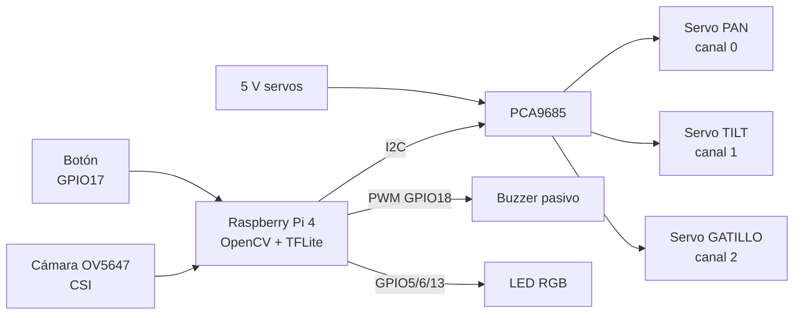

# Torreta CIWS con IA (Raspberry Pi 4)

Proyecto de **Inteligencia Artificial en Dispositivos Móviles y Embebidos (Miniproyecto 3)**. Es una torreta pan-tilt inspirada en los sistemas CIWS. Con un solo botón hace un barrido, identifica figuras con un **modelo MobileNetV2 entrenado con un dataset propio** y corriendo en **TensorFlow Lite**, y responde a cada clase con una acción distinta. Funciona como un sistema de identificación amigo-enemigo (IFF).

**Autor:** Juan Camilo Díaz Rangel (2215469)


## Clases y acciones

| Clase | Rol | Prioridad | Acción |
|---|---|---|---|
| `triangulo` | Misil | 1 | LED rojo intermitente, alarma, seguimiento 2 s, **ráfaga de 3 disparos** |
| `cuadrado` | Avión enemigo | 2 | LED naranja, dos pitidos, seguimiento 2 s, **1 disparo** |
| `estrella` | Dron | 3 | LED amarillo intermitente, tono de advertencia, **vigilancia 4 s sin disparo** |
| `circulo` | Aliado | 4 | LED verde, melodía, **asiente con la cabeza** |
| `cruz` | Civil / médico | 5 | LED morado, tono grave, **niega con la cabeza: disparo bloqueado** |
| `otro` *(opcional)* | No es objetivo | — | Se ignora |

Si el modelo no supera el 80 % de confianza, la figura queda como `desconocido` y no se actúa.

## Ciclo (un solo botón)



**Localización y clasificación.** OpenCV solo encuentra *dónde* hay una figura: binariza con Otsu y busca contornos con jerarquía. *Qué* figura es lo decide la red neuronal, a partir del recorte. Como en la Raspberry Pi 4 el proyecto debe ser de **clasificación**, esta división cumple la rúbrica y aun así la torreta puede apuntar. El recorte es el mismo al capturar el dataset y al clasificar, así que el modelo ve en la presentación el mismo tipo de imagen con el que se entrenó.

## Diagrama de bloques del hardware



**Actuadores (mínimo 3):** servo pan, servo tilt, servo gatillo y buzzer, en total **4**. El LED RGB es complementario.

## Conexiones

| Elemento | Pin de la Raspberry |
|---|---|
| PCA9685 VCC / GND / SDA / SCL | 3.3 V (pin 1) / GND (pin 6) / GPIO2 (pin 3) / GPIO3 (pin 5) |
| PCA9685 V+ (bornera) | 5 V aparte para los servos, con la GND unida a la de la Pi, y un condensador de 470–1000 µF |
| Servos pan / tilt / gatillo | PCA9685 canales 0 / 1 / 2 |
| Botón (pulsador) | GPIO17 (pin 11) y GND (pin 9); usa el pull-up interno |
| Buzzer pasivo (módulo KY-006) | Señal en GPIO18 (pin 12), GND (pin 14) |
| LED RGB de cátodo común | R → GPIO5 (pin 29), G → GPIO6 (pin 31), B → GPIO13 (pin 33), cada uno con 220 Ω; cátodo a GND (pin 34) |

## Estructura

| Carpeta | Contenido |
|---|---|
| `software/torreta_ia.py` | Programa principal: ciclo completo, seguimiento, acciones y reporte |
| `software/vision.py` | Cámara, localización de figuras y recorte |
| `software/clasificador.py` | Inferencia TFLite (LiteRT / tflite-runtime) |
| `software/hardware.py` | Servos (PCA9685), buzzer, LED RGB y botón, con modo simulado |
| `software/capturar_dataset.py` | Captura del dataset propio con la cámara de la torreta |
| `software/instalar.sh` | Instalación en Raspberry Pi OS y servicio de arranque automático |
| `software/modelo/` | Aquí van `modelo_torreta.tflite` y `etiquetas.txt` |
| `entrenamiento/Entrenamiento_Torreta_IA.ipynb` | Notebook de Colab: MobileNetV2, fine-tuning, métricas y exportación a TFLite |
| `figuras_objetivo/` | PDF con las figuras para imprimir y el tablero de demostración |
| `Diseño 3D/` | Piezas y ensamble de SolidWorks, STL e imágenes |
| `Diseño original/` | STEP/STL del diseño base descargado |
| `Lista_de_compras.md` | Materiales, precios aproximados y montaje |

## Paso a paso

1. **Imprimir y armar** la torreta (`Diseño 3D/STL_Impresion`) y conectar todo según la tabla.
2. **Instalar** en la Raspberry: `cd software && bash instalar.sh`.
3. **Imprimir las figuras**: `figuras_objetivo/Figuras_para_imprimir.pdf`, una hoja por clase. Conviene imprimir también versiones de otro tamaño y algunas dibujadas a mano con marcador, para que el dataset tenga variedad.
4. **Capturar el dataset** con la cámara de la torreta. Se recomiendan unas 300 imágenes por clase, cambiando distancia, giro, luz y fondo:
   ```bash
   ~/torreta-venv/bin/python capturar_dataset.py --clase triangulo --n 300 --ver
   # repetir con cuadrado, circulo, estrella, cruz y (opcional) otro
   zip -r dataset_torreta.zip dataset
   ```
5. **Entrenar en Colab**: subir `dataset_torreta.zip` a Google Drive y ejecutar `entrenamiento/Entrenamiento_Torreta_IA.ipynb` con GPU. El notebook descarga `modelo_torreta.zip`, con el modelo y las figuras para el informe.
6. **Copiar el modelo** a `software/modelo/` y probar:
   ```bash
   ~/torreta-venv/bin/python torreta_ia.py --solo-vision --ver   # verifica la clasificación y mide la latencia
   ~/torreta-venv/bin/python torreta_ia.py --ver                 # ciclo completo con el botón
   ```
   Si la torreta se mueve al revés del objetivo, cambia `SIGNO_PAN` o `SIGNO_TILT` en `torreta_ia.py`.
7. **Producto final**: `sudo systemctl enable --now torreta`. La torreta arranca sola al encender la Pi y solo hay que oprimir el botón. Mantener el botón 3 s la apaga.
8. **(Opcional) Aviso a Telegram** con la foto de cada objetivo, como el correo del ejemplo de la rúbrica: crear `~/.torreta_env` con `TORRETA_TELEGRAM_TOKEN=...` y `TORRETA_TELEGRAM_CHAT=...`.

Cada ciclo guarda las fotos de cada objetivo en `software/registros/<fecha>/` y agrega una fila por objetivo en `software/registros/historial.csv`.

**Prueba en el PC sin la Raspberry:** `python torreta_ia.py --sim --ver` usa la webcam y simula los servos, el buzzer y el LED. Enter o la barra espaciadora hacen de botón. Necesita el modelo y `tensorflow` o `ai-edge-litert` instalados.

## Cumplimiento de la rúbrica

| Requisito | Cómo se cumple |
|---|---|
| Tarjeta de desarrollo (no celular) | Raspberry Pi 4 |
| Clasificación en la Pi 4 | MobileNetV2 clasifica cada figura; OpenCV solo la localiza |
| Dataset personalizado de al menos 5 clases | 5 figuras (+ `otro`) capturadas con la misma cámara de la torreta |
| Entrenamiento en Python (Colab) | `Entrenamiento_Torreta_IA.ipynb`: transfer learning + fine-tuning, matriz de confusión, TFLite |
| Mínimo 3 actuadores | 4: servo pan, servo tilt, servo gatillo y buzzer (el LED es complementario) |
| Cada clase ejecuta una acción | Tabla de clases y acciones: las 5 son distintas |
| Completamente automático con un botón | Barrido, clasificación, seguimiento, acciones y reporte; arranque con systemd |
| ODS | **ODS 9** (industria, innovación e infraestructura): IA en el borde, de bajo costo y sin nube. **ODS 16** (paz y justicia): el bloqueo de disparo ante civiles y aliados aplica el principio de distinción del Derecho Internacional Humanitario a un sistema autónomo |

## Créditos
- Las piezas Base, Fork y Head son del diseño *"Pan-Tilt Camera Turret for 9g Servos (SG90)"*, descargado de internet; los archivos están sin cambios en `Diseño original/`. El adaptador de la cámara, el ensamble y el software son de este proyecto.
- El flujo de entrenamiento parte del notebook de clasificación de tapabocas visto en clase (MobileNetV2 + TFLite). Las correcciones que se le hicieron están explicadas al inicio del notebook.
- MobileNetV2: Sandler *et al.*, "MobileNetV2: Inverted Residuals and Linear Bottlenecks", CVPR 2018.
